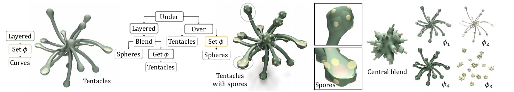
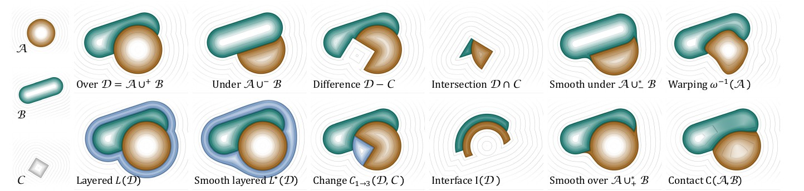
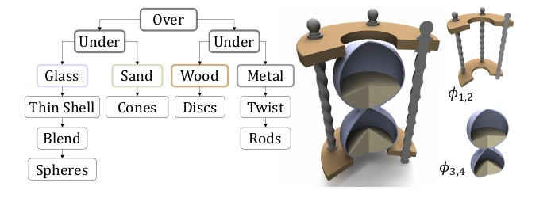
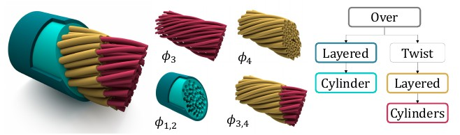
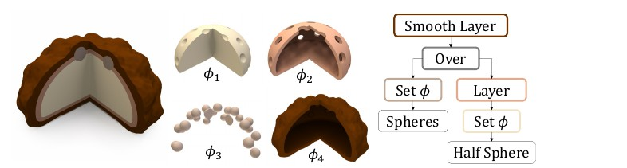
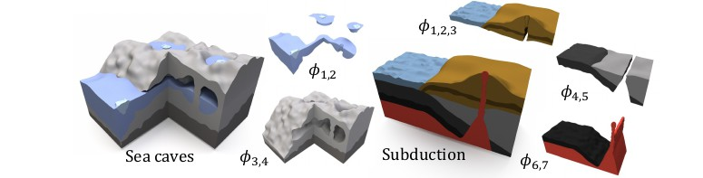
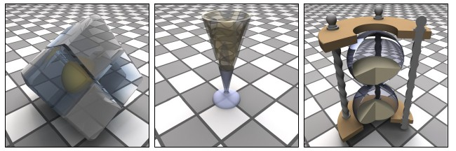

# The PhaseTree: Multiphase Signed Distance Fields

[](https://perso.liris.cnrs.fr/eric.galin/Articles/2026-phasetree.pdf)
[](https://doi.org/10.1145/3811379)
[](https://www.youtube.com/watch?v=guirU6IBn1w&t=1s)
[](LICENCE)

This repository contains the GLSL source code of the ACM Transactions on Graphics / SIGGRAPH 2026 paper
**"[The PhaseTree: Multiphase Signed Distance Fields](https://perso.liris.cnrs.fr/eric.galin/Articles/2026-phasetree.pdf)"**,
by [Eric Galin](https://perso.liris.cnrs.fr/eric.galin/), Pierre Hubert-Brierre, Hugo Schott, Marie-Paule Cani, Adrien Peytavie and Eric Guérin.



*A tentacle model built from a few thousand primitives with four different phases. The PhaseTree is a hierarchical multiphase signed distance representation that supports efficient modeling, fast queries, and real-time rendering of complex volumetric objects.*

## Abstract

We introduce the PhaseTree, a novel hierarchical construction-tree representation for compactly modeling volumetric objects composed of multiple phases or materials across scales. An object is defined as a single construction tree that combines phase-aware primitives through composition and warping operators, yielding a unified multiphase signed distance representation that naturally supports complex topologies and interfaces between phases. The PhaseTree is compatible with standard signed distance field workflows: single-phase algorithms can be directly promoted to a PhaseTree, and conversely reduced without loss of information. As a result, our model integrates seamlessly with existing algorithms and rendering pipelines. We extend classical Sphere Tracing to robustly handle multiphase configurations and show that, despite the additional expressiveness, our implementation preserves the compactness and resolution independence of signed distance fields and incurs less than a 25% runtime overhead compared to single-phase Sphere Tracing.

## Video

[](https://www.youtube.com/watch?v=guirU6IBn1w&t=1s)

More videos are available on the [Arches Team YouTube channel](https://www.youtube.com/@ArchesTeam).

## Fundamentals

A multiphase object is defined by a multiphase signed distance function **Φ(p) = (φ₁(p), …, φₙ(p))** where every φᵢ is a 1-Lipschitz (or conservative) signed distance bound to the region occupied by phase *i*. At any point in space, at most one phase is negative: the point lies inside that phase, or outside of all phases. In the GLSL code, a multiphase value is stored as a `vec4`, *i.e.* up to four phases; a phase that is absent is set to the large constant `E = 1e4`.

Objects are defined as functions `vec4 Object(vec3 p)` returning the four phase values. The renderer sphere-traces `MinPhase(Object(p))`, and the phase at the hit point is given by `MinIndex`.

The shared code is in the [GLSL/common](GLSL/common) directory, and is included by the example models:

- [common/sdf.glsl](GLSL/common/sdf.glsl): signed distance field primitives and operators.
- [common/multiphase.glsl](GLSL/common/multiphase.glsl): multiphase primitives, multiphase (internal) operators and hybrid operators.
- [common/blobtree.glsl](GLSL/common/blobtree.glsl): BlobTree primitives and conversion to a signed distance field.
- [common/render.glsl](GLSL/common/render.glsl): multiphase Sphere Tracing, normals, shading and the `Render` function.

A model only needs to include `common/render.glsl` (which includes the multiphase and signed distance field code), define `Object` and call `Render` from `mainImage`. [void.glsl](GLSL/void.glsl) simply defines a sphere with a single phase, and is the minimal setup to start from when writing other models:

```glsl
#define STEPS 500 // Optional: maximum number of Sphere Tracing steps (default 200), EPSILON can also be defined
#include "common/render.glsl"

vec4 Object(vec3 p) {
  return Set(Sphere(p, vec3(0.0), 3.0), 1);
}

void mainImage(out vec4 color, in vec2 pxy) {
  vec3 rgb = Render(pxy, iResolution.xy, iMouse.xy, vec3(24., 0., 5.), vec3(0., 0., 0.));
  color = vec4(rgb, 1.);
}
```



*Visual representation of some operators: A and B are two objects with their corresponding phase functions, C is a signed distance field.*

## List of operators

### Signed distance field primitives — [common/sdf.glsl](GLSL/common/sdf.glsl)

| Function | Description |
|---|---|
| `float Sphere(vec3 p, vec3 c, float r)` | Sphere of center `c` and radius `r` |
| `float Box(vec3 p, vec3 c, vec3 r)` | Axis-aligned box of center `c` and half size `r` |
| `float Slab(vec3 p, vec3 c, vec3 n, float r)` | Infinite slab through `c`, normal `n`, half thickness `r` |
| `float Capsule(vec3 p, vec3 a, vec3 b, float r)` | Capsule around segment `[a,b]` with radius `r` |
| `float Cylinder(vec3 p, vec3 a, vec3 b, float r)` | Capped cylinder of axis `[a,b]` and radius `r` |
| `float Cone(vec3 p, vec2 c, float h)` | Cone with apex at the origin, `c` is the sine/cosine of the angle and `h` the height |

### Signed distance field operators — [common/sdf.glsl](GLSL/common/sdf.glsl)

| Function | Description |
|---|---|
| `float U(float a, float b)`, `U(a, b, c)` | Union (binary and ternary) |
| `float SU(float a, float b, float r)` | Smooth union with blending radius `r` |
| `float I(float a, float b)` | Intersection |
| `float D(float a, float b)` | Difference |
| `float SD(float a, float b, float r)` | Smooth difference with blending radius `r` |
| `float Round(float a, float r)` | Offset/rounding by `r` |

### BlobTree — [common/blobtree.glsl](GLSL/common/blobtree.glsl)

| Function | Description |
|---|---|
| `float Falloff(float x, float R)` | Smooth cubic falloff function |
| `vec2 Point(vec3 p, vec3 c, float e, float R)` | Point skeleton primitive, returns the field and the distance to the compact support |
| `vec2 Blend(vec2 a, vec2 b)` | Blending of two BlobTree sub-trees |
| `float BlobToSdf(vec2 v, float k)` | Converts a BlobTree field with Lipschitz constant `k` into a signed distance bound |

The following functions are in [common/multiphase.glsl](GLSL/common/multiphase.glsl).

### Multiphase primitives

| Function | Description |
|---|---|
| `vec4 Set(float a, int m)` | Promotes a signed distance field `a` to a multiphase object with phase `m` (*Set φ* in the paper) |
| `vec4 Checker(vec3 p, int a, int b)` | Infinite two-phase 3D checker |
| `vec4 Checker(vec3 p, int n)` | Infinite 3D checker with cells randomly assigned to `n` phases |
| `vec4 Slicer(vec3 p, int a, int b, vec3 uz, float e)` | Infinite two-phase wavy slabs of thickness `e` |

### Multiphase operators

| Function | Description |
|---|---|
| `vec4 Under(vec4 a, vec4 b)` | Under operator A ∪⁻ B: `b` is placed under `a` |
| `vec4 Under(vec4 a, float b, int m)` | Under operator with a single-phase field `b` of phase `m` |
| `vec4 Over(vec4 a, vec4 b)` | Over operator A ∪⁺ B: `b` is placed over `a` |
| `vec4 Contact(float a, float b, int ma, int mb, float r)` | Contact between two fields with phases `ma` and `mb`, `r` is the contact coefficient |
| `vec4 ContactSmooth(float a, float b, int ma, int mb, float r, float c)` | Smooth contact with blending radius `r` and contact coefficient `c` |
| `vec4 Get(vec4 v, int m)` | Keeps only phase `m` (*Get φ* in the paper) |
| `vec4 Remove(vec4 v, int m)` | Removes phase `m` |
| `vec4 Shrink(vec4 v, float r)` | Shrinks all phases by offset `r` |

### Hybrid operators

Hybrid operators combine a multiphase object with a standard signed distance field.

| Function | Description |
|---|---|
| `vec4 Intersection(vec4 a, float b)` | Intersection D ∩ C |
| `vec4 Difference(vec4 a, float b)` | Difference D − C |
| `vec4 Change(vec4 a, float b, int ma, int mb)` | Localized phase change C<sub>ma→mb</sub>(D, C): phase `ma` becomes `mb` inside `b` |

### Queries

| Function | Description |
|---|---|
| `float MinPhase(vec4 v)` | Minimum over all phases: the signed distance to the union of all phases, used for Sphere Tracing |
| `int MinIndex(vec4 v)` | Index of the phase with the minimum value, *i.e.* the phase at point `p` |
| `float GetIth(vec4 v, int i)` | `i`-th phase value, provided in case of an array implementation |

## Multiphase example models

| Model | Description |
|---|---|
| [hourglass.glsl](GLSL/hourglass.glsl) | An hourglass assembled from 4 different phases (glass, sand, wood, metal) using the `Over`, `Under` and hybrid `Difference` operators |
| [contact.glsl](GLSL/contact.glsl) | Animated contact surface between two phases |
| [checker.glsl](GLSL/checker.glsl) | Infinite random multiphase checker intersected with a blobby shape |
| [blobtree.glsl](GLSL/blobtree.glsl) | A BlobTree model converted to a signed distance field and sliced with wavy two-phase slabs |
| [void.glsl](GLSL/void.glsl) | A single-phase sphere, minimal rendering template |



*An hourglass, modeled by assembling 4 different phases (Figure 18 of the paper), implemented in [hourglass.glsl](GLSL/hourglass.glsl).*

## Gallery

| | |
|:---:|:---:|
|  |  |
| Twisted electrical cables enclosed within a flexible insulating sheath | An entremet modeled through successive phase layers |
|  |  |
| Three dimensional terrains featuring different volumetric information | Glass models with transparent phases |

## Requirements

We provide a simple GLSL implementation of some examples, directly renderable using [Visual Studio Code](https://code.visualstudio.com/) with the [ShaderToy](https://marketplace.visualstudio.com/items?itemName=stevensona.shader-toy) extension, which resolves the `#include` directives. The default settings of the extension work, even when a single shader file is opened. If you set `shader-toy.webglVersion` to `WebGL2`, the option `shader-toy.testCompileIncludedFiles` must be disabled, because `common/render.glsl` does not compile on its own: this is done by the [.vscode/settings.json](.vscode/settings.json) file of this repository when the repository folder is opened in Visual Studio Code.

[Shadertoy](https://www.shadertoy.com/) does not support `#include`: paste the contents of `common/sdf.glsl`, `common/multiphase.glsl`, `common/blobtree.glsl` (for the BlobTree model only) and `common/render.glsl`, in this order, in the *Common* tab without the `#include` lines, and the model in the *Image* tab without its `#include` lines. As the *Common* tab comes first, `STEPS` and `EPSILON` defined in the model are ignored: define them at the top of the *Common* tab instead.

Use the mouse to rotate the camera (horizontal axis) and zoom (vertical axis). The bottom-left inset shows the number of Sphere Tracing steps in false colors.

## Citation

You can use this code in any way you want, however please credit the original article:

> Eric Galin, Pierre Hubert-Brierre, Hugo Schott, Marie-Paule Cani, Adrien Peytavie, and Eric Guérin. 2026. The PhaseTree: Multiphase Signed Distance Fields. *ACM Trans. Graph.* 45, 4, Article 55 (July 2026), 13 pages. https://doi.org/10.1145/3811379

```bibtex
@article{Galin2026PhaseTree,
  author    = {Eric Galin and Pierre Hubert-Brierre and Hugo Schott and Marie-Paule Cani and Adrien Peytavie and Eric Gu{\'e}rin},
  title     = {The PhaseTree: Multiphase Signed Distance Fields},
  journal   = {ACM Transactions on Graphics},
  volume    = {45},
  number    = {4},
  articleno = {55},
  numpages  = {13},
  month     = jul,
  year      = {2026},
  doi       = {10.1145/3811379}
}
```

## Links

- Paper: [PDF](https://perso.liris.cnrs.fr/eric.galin/Articles/2026-phasetree.pdf) — [DOI 10.1145/3811379](https://doi.org/10.1145/3811379)
- Video: [YouTube](https://www.youtube.com/watch?v=guirU6IBn1w&t=1s) — [Arches Team channel](https://www.youtube.com/@ArchesTeam)
- Author web page: [Eric Galin](https://perso.liris.cnrs.fr/eric.galin/)

## License

See [LICENCE](LICENCE) for details on the license of this project (MIT).
